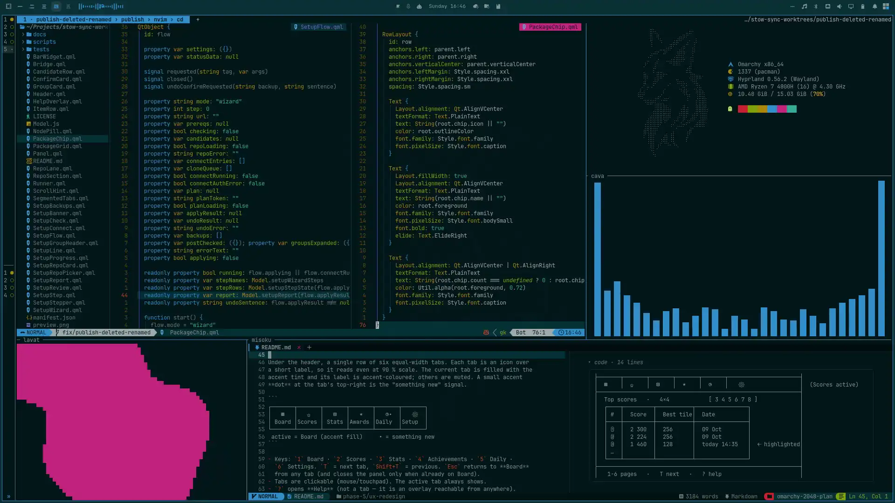
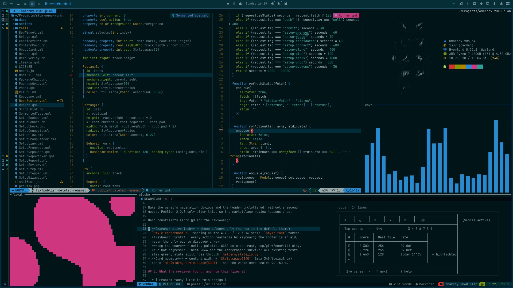

<!-- Optional banner: uncomment for a gradient wave above the typing line. capsule-render is a
     third-party service; if its host is ever down the image simply disappears. Verified working
     2026-10-18 — swap `color=gradient` for a hex value to match the palette more literally.

  

-->

  

<!-- Old header, kept as a fallback (third-party typing service):

  

-->

I make my Arch desktop do exactly what I want, then build the small tools it's still missing.
Most of them ship as [Omarchy](https://omarchy.org) plugins.

---

## Right now

  

Omarchy 4 + <a href="https://github.com/pwn27sbx/omarchy-solarized-osaka-theme">Solarized Osaka</a> — Neovim on Stow Sync's own QML, fastfetch, cava, lavat, and my notes in <a href="https://github.com/pwn27sbx/misoku">Misoku</a>.

<!-- Commit the compressed shot to the profile repo as assets/omarchy-setup.webp first:
     magick omarchy-setup.png -strip -quality 85 omarchy-setup.webp
     (422 KB -> ~182 KB; PNG fallback command in proposals.md) -->

## Setups over time

KDE, then Hyprland, and now Omarchy.

<table>
  <tr>
    <td align="center" width="33%"></td>
    <td align="center" width="33%"></td>
    <td align="center" width="33%"></td>
  </tr>
</table>

<!-- Contribution graphs, pair 1: generated daily by .github/workflows/contributions.yml onto the
     `output` branch. Before the first run of that workflow these cells render empty; if a run
     fails later, the branch keeps its last good SVGs. -->
<table>
  <tr>
    <td align="center" width="50%">
      
    </td>
    <td align="center" width="50%">
      
    </td>
  </tr>
</table>

## What I'm building

  
  &nbsp;&nbsp;
  
  &nbsp;&nbsp;
  

<a href="https://github.com/pwn27sbx/2048">2048</a> &nbsp;·&nbsp; <a href="https://github.com/pwn27sbx/omarchy-better-notifications">Better Notifications</a> &nbsp;·&nbsp; <a href="https://github.com/pwn27sbx/omarchy-solarized-osaka-theme">Solarized Osaka</a>

Small tools for the desktop I actually use:

- **[Stow Sync](https://github.com/pwn27sbx/stow-sync)** — an Omarchy bar plugin for dotfiles that live in GNU Stow repos: it watches commit, push and link state, and can set up a fresh machine from them in one guided flow. It's in the Omarchy plugin marketplace.
- **[Misoku](https://github.com/pwn27sbx/misoku)** — a block-based Markdown notebook for the terminal; your notes stay plain Markdown files. It's my daily notebook.
- **[2048](https://github.com/pwn27sbx/2048)** — the classic game as a keyboard-driven, theme-aware Omarchy bar panel. Six board sizes, undo, stats, a daily challenge.
- **[Mini Cider](https://github.com/pwn27sbx/omarchy-mini-cider)** — a native mini player for Cider (Apple Music) that lives in the bar.
- **[Better Notifications](https://github.com/pwn27sbx/omarchy-better-notifications)** — a denser, tidier notification center for the Omarchy shell.
- **[Solarized Osaka for Omarchy](https://github.com/pwn27sbx/omarchy-solarized-osaka-theme)** — the theme in the big shot above.
- **[qs-novelmangareader](https://github.com/pwn27sbx/qs-novelmangareader-es)** — anime, manga and novel side panels for your desktop, built on Quickshell.

<!-- Contribution graphs, pair 2: same workflow as pair 1 above. -->
<table>
  <tr>
    <td align="center" width="50%">
      <picture>
        <source media="(prefers-color-scheme: dark)" srcset="https://raw.githubusercontent.com/pwn27sbx/pwn27sbx/output/pacman-contribution-graph-dark.svg" />
        <source media="(prefers-color-scheme: light)" srcset="https://raw.githubusercontent.com/pwn27sbx/pwn27sbx/output/pacman-contribution-graph.svg" />
        
      </picture>
       eaten by Pac-Man
    </td>
    <td align="center" width="50%">
      <picture>
        <source media="(prefers-color-scheme: dark)" srcset="https://raw.githubusercontent.com/pwn27sbx/pwn27sbx/output/breakout-contribution-graph-dark.svg" />
        <source media="(prefers-color-scheme: light)" srcset="https://raw.githubusercontent.com/pwn27sbx/pwn27sbx/output/breakout-contribution-graph.svg" />
        
      </picture>
       broken by Breakout
    </td>
  </tr>
</table>

## Small fixes, sent upstream

When something I use has a rough edge, I can't leave it alone:

- [omacodesnap](https://github.com/keithrowell/omarchy-plugin-omacodesnap/pulls?q=is%3Apr+author%3Apwn27sbx) — Neovim snaps from Ghostty, tmux and herdr (three PRs, merged).
- [omarchy-config-sync](https://github.com/gladimdim/omarchy-config-sync-plugin/pull/4) — dynamic scroll area in the Overview panel (merged).
- [auto-wallpaper](https://github.com/JJDizz1L/dizziee.auto-wallpaper/pull/2) — cached thumbnails for symlinked wallpapers, centered preview grid (#2, #3).
- [Omarchy music flow](https://github.com/Clifford-Baidoo/Omarchy-music-flow/pull/11) — debounced MPRIS signals, so quickshell stops crashing when a player exits (#11).
- [omarchy-totp](https://github.com/sasiruLK/omarchy-totp/pull/3) — batch secret loading to avoid a keyring DBus crash (#3).
- [Dark Reader](https://github.com/darkreader/darkreader/issues/16114) — reported: borders get too bright on very dark backgrounds.

---

  

<!-- The 3D rainbow skyline closes the graph set; one file, handles both modes by itself. -->

  
   as a rainbow skyline

<a href="https://x.com/Fs3b4S">x</a> &nbsp;·&nbsp; <a href="https://www.reddit.com/user/pwn27sbx/">reddit</a>

• Arch Linux • Hyprland • Lazyvim • Ghostty • Zen • Go • TypeScript • Python • Docker

• Games • Anime • Music • Code

